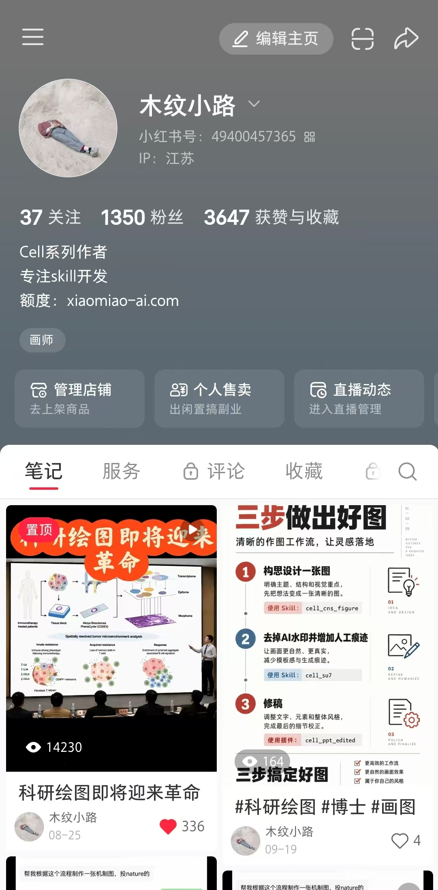
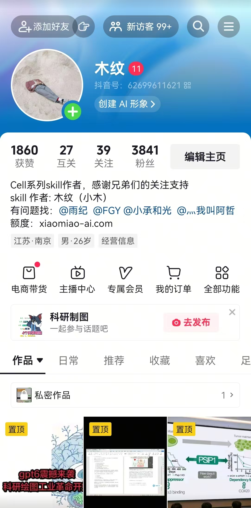

# cell_cns_figure

根据科研文字或参考图制作科研图，支持**识别路径**，可选择在 **SVG、PowerPoint 或 Adobe Illustrator** 中展示和编辑。

| 方案 | 建议 |
| --- | --- |
| **1号** | **日常使用选1即可**，支持文字、图片或图文一起 |
| **2号** | **适合高嵌套文件，更注重美观**，支持文字、图片或图文一起 |

使用时选择1号或2号，再选择识别路径后的展示方式：

| 展示方式 | 返回文件 |
| --- | --- |
| **SVG** | 可编辑 SVG |
| **PowerPoint** | 可编辑 PPTX，同时保留 SVG |
| **Adobe Illustrator** | 可编辑 AI，同时保留 SVG |

文字保持文字，可直接修改；图形可逐个编辑。已指定展示方式时直接沿用。

**仅2号（Pro）需要一次性邀请码**，生成后24小时内有效。1号不需要邀请码。

## 联系方式

邮箱：[a2417220276@gmail.com](mailto:a2417220276@gmail.com)。添加好友时请备注 **Cell 使用交流**。

<table>
  <tr>
    <td align="center"><strong>微信：木纹</strong></td>
    <td align="center"><strong>小红书：木纹小路</strong></td>
    <td align="center"><strong>抖音：木纹</strong></td>
  </tr>
  <tr>
    <td></td>
    <td></td>
    <td></td>
  </tr>
</table>
